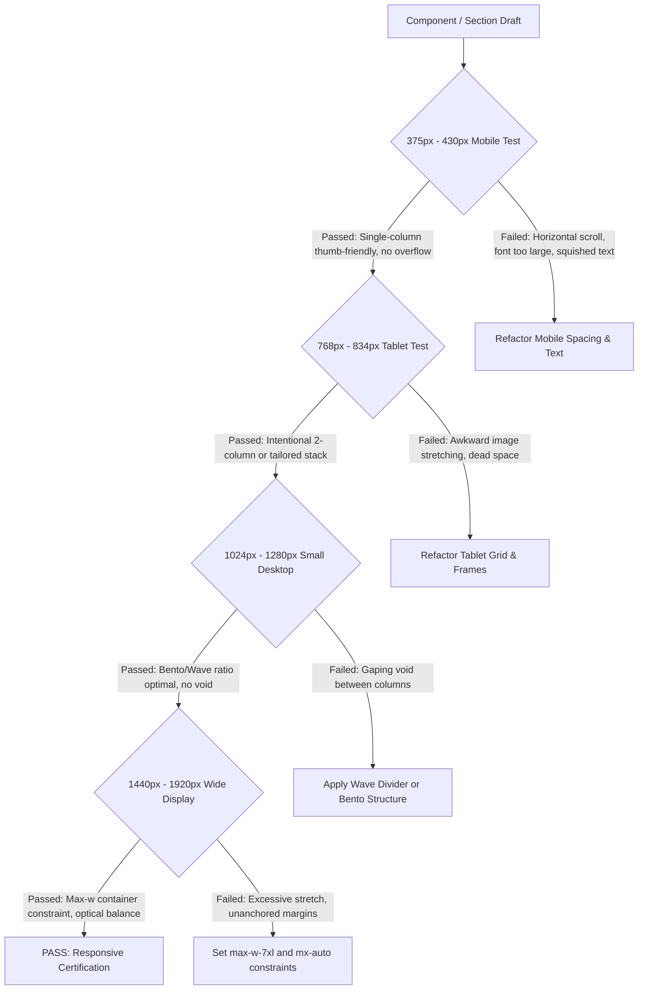

# Skill 04: Quality Assurance & Design Taste Verification Engine

> **Document Type:** Production Engineering & Design Verification Standard  
> **Target Audience:** Frontend Engineers, Design System Architects, Code Reviewers  
> **Source of Truth:** Client Taste Dossier (`taste.docx`), WCAG 2.2 AAA/AA Guidelines, React/Tailwind/Framer Motion Best Practices  

---

## 1. Executive Summary & Purpose

This QA Verification Engine enforces rigorous code and aesthetic standards. It translates the client's explicit design preferences and strong aversions into an actionable, pass/fail verification protocol.

Any page, component, or layout generated for this project must pass through this evaluation pipeline before it is considered production-ready.

---

## 2. The Client Taste Enforcement Protocol: The 4 Non-Negotiable Anti-Patterns

The client has outlined four visual anti-patterns that signify template-generated, uncrafted work. Every QA review must explicitly audit against these anti-patterns.

```
+----------------------------------------------------------------------------------------------------+
|                                    STRICT ANTI-PATTERN AUDIT MATRIX                                |
+------------------------------------+----------------------------------+----------------------------+
| Anti-Pattern Detected               | Visual Symptom                   | Mandatory Remediation      |
+------------------------------------+----------------------------------+----------------------------+
| 1. The Vast Empty Void             | Huge monocolor canvas, tiny text | Bridge negative space with |
|    (Pepsi / Sadek syndrome)        | on left, isolated product right  | organic wave dividers,     |
|                                    | with gaping dead space between.  | bento structuring, or      |
|                                    |                                  | layered atmospheric depth. |
+------------------------------------+----------------------------------+----------------------------+
| 2. The Confetti Circle Avatar      | Circular headshot cutout stuck   | Use architectural frames   |
|    (Dawood syndrome)               | in space, surrounded by random   | (arches/pills), rich bento |
|                                    | floating dots, confetti, stars.  | preview cards, or modern   |
|                                    |                                  | UI context layering.       |
+------------------------------------+----------------------------------+----------------------------+
| 3. Childish Clip-Art Icons         | Thick black outline cartoon      | Strict Lucide-React stroke |
|    (Alyasmeen syndrome)            | illustrations, multi-colored     | icons (1.5-2px stroke) or  |
|                                    | flat sticker graphics.           | crafted custom SVG lines.  |
+------------------------------------+----------------------------------+----------------------------+
| 4. Generic "AI Template" Look      | Saturated cyan/purple gradient   | Refined editorial fonts,   |
|    (RenderVault / Nabed syndrome)  | text in mid-sentence, dark bg,   | earth/midnight palettes,   |
|                                    | 3D squircle render, generic      | purposeful micro-cards     |
|                                    | "10k+ / 50k+ / 4.9*" stat pill.  | with authentic data.       |
+------------------------------------+----------------------------------+----------------------------+
```

### Detailed Failure Conditions & Remediation Rules

#### Audit 2.1: The Vast Empty Void Check
* **Failure Trigger:** When an inspection of desktop viewports (1024px to 1920px) reveals an empty gulf of background color (> 300px horizontal or vertical gap) between the headline block and the graphic asset, where neither background gradients, fluid wave dividers, nor contextual UI cards bridge the two columns.
* **Pass Criteria:**
  - Layout is purposefully bridged using either:
    1. An organic SVG wave divider separating distinct color planes (ClickUp style).
    2. A structured bento grid that spans the container without dead margins.
    3. Secondary contextual floating micro-cards (user quote, live rating, metric badge).
    4. An atmospheric gradient mesh / subtle vignette that tethers the graphic to the background.

#### Audit 2.2: Avatar & Subject Framing Check
* **Failure Trigger:** A round `rounded-full` headshot or floating subject with floating decorative confetti dots, sparkles, or cartoon stars loosely scattered around it.
* **Pass Criteria:**
  - Photography and 3D subjects are housed inside **architectural frames** (e.g., custom pill or arched containers with `rounded-t-[140px] rounded-b-[40px]`), or contextual interface mockups.
  - Secondary elements are contextual interactive cards (e.g., an authentic testimonial card, a mini metric chart, or an interactive tool preview), not arbitrary confetti particles.

#### Audit 2.3: Iconography & Illustration Check
* **Failure Trigger:** Any iconography featuring multi-color cartoon fills, thick black outlines, emoji-like graphics, or flat vector clip-art.
* **Pass Criteria:**
  - Exclusively clean, high-precision SVG line icons (preferably `lucide-react` with a stroke width of `1.5px` or `2px`).
  - Icons are monochromatic (inheriting `text-primary` or `text-muted-foreground`) or enclosed in a refined frosted-glass pill badge (`bg-white/10 dark:bg-white/5 border border-white/10`).
  - Complex illustrations are scalable, animatable SVG vector drawings with clean lines and harmonious brand palettes.

#### Audit 2.4: Generic AI Aesthetics Check
* **Failure Trigger:**
  - Mid-sentence neon gradient spans (e.g., `We build <span className="text-transparent bg-clip-text bg-gradient-to-r from-cyan-400 to-purple-600">future tech</span> for brands`).
  - Standard three-pill stats crammed under the CTA (`[10K+ Users] [99.9% Uptime] [4.9 Rating]`).
  - Floating shiny 3D squircle renders sitting isolated in a generic rounded box.
* **Pass Criteria:**
  - Typography utilizes refined pairings (e.g., geometric sans-serif headers paired with an editorial italic serif accent or pure minimalist high-contrast typography).
  - Social proof and metrics are integrated into organic cards or authentic customer verification badges.
  - Assets represent tangible product UI previews, architectural spaces, or purposeful vector artwork.

---

## 3. Comprehensive Multi-Device Breakpoint Audit

Every layout must be tested and verified against four mandatory responsive breakpoints. Stacking must feel deliberate and designed, not like an accidental overflow wrap.



### Breakpoint Specifications

| Viewport | Device Class | Max Content Width | Layout Strategy & Rules |
| :--- | :--- | :--- | :--- |
| **375px - 430px** | Mobile (iPhone / Pixel) | `w-full px-4 sm:px-6` | - Full-width stacked hierarchy.<br>- Headlines scaled down (e.g., `text-3xl sm:text-4xl`).<br>- CTAs full width or centered with minimum 48px touch target.<br>- Secondary floating cards docked beneath the main visual or hidden to prevent visual clutter.<br>- Zero horizontal layout shift or overflow (`overflow-x-clip`). |
| **768px - 834px** | Tablet (iPad / Surface) | `max-w-2xl sm:px-8` | - Avoid unstyled 50/50 split that causes awkward line breaks.<br>- Use structured vertical stacking with tight visual coupling or tailored 60/40 proportion.<br>- Architectural frames scale proportionally (`aspect-[4/3]` or `aspect-[16/10]`). |
| **1024px - 1280px** | Laptop / Standard Monitor | `max-w-6xl px-8` | - Two-column or bento grid engages fully.<br>- Wave dividers divide canvas cleanly without clipping text.<br>- Floating UI cards position relative to container boundaries with negative margin or absolute offset. |
| **1440px - 1920px+** | Wide Desktop / Retina | `max-w-7xl mx-auto px-8` | - Main content constrained in container; background gradients or wave fills bleed to full screen.<br>- Content must not stretch into giant unreadable line lengths (max 65-75 characters per line). |

---

## 4. Framer Motion Performance & Interaction Audit

Animations must feel fluid, tactile, and natural. Jerky transitions, layout shifts, and CPU-intensive property animations are grounds for immediate QA failure.

### Performance Rules
1. **Animate Transform and Opacity Only:**
   - NEVER animate `width`, `height`, `margin`, `padding`, `top`, `left` directly during micro-interactions.
   - Animate `scale`, `x`, `y`, `opacity`, and `rotate`.
   - For collapsible containers (e.g. accordion), use `layout` or `AnimatePresence` with controlled height transitions.
2. **Hardware Acceleration Flags:**
   - Add `will-change-transform` or `translateZ(0)` on continuously floating cards or organic wave elements.
3. **Respect Accessibility (`prefers-reduced-motion`):**
   - Use the `useReducedMotion()` hook or Framer Motion's automatic reduced-motion detection.

```tsx
// Example of compliant motion configuration
import { motion, useReducedMotion } from "framer-motion";

export const SafeAnimatedCard = ({ children, delay = 0 }: { children: React.ReactNode; delay?: number }) => {
  const shouldReduceMotion = useReducedMotion();

  const variants = {
    hidden: { opacity: 0, y: shouldReduceMotion ? 0 : 20 },
    visible: {
      opacity: 1,
      y: 0,
      transition: {
        duration: 0.5,
        delay,
        ease: [0.21, 0.47, 0.32, 0.98], // Custom spring curve
      },
    },
  };

  return (
    <motion.div
      initial="hidden"
      whileInView="visible"
      viewport={{ once: true, margin: "-50px" }}
      variants={variants}
      className="will-change-transform"
    >
      {children}
    </motion.div>
  );
};
```

---

## 5. Typography, Contrast & Color Accessibility Checklist

| Item | Requirement | Verification Method | Pass Threshold |
| :--- | :--- | :--- | :--- |
| **Primary Text Contrast** | High readability on light & dark backgrounds | WebAIM Contrast Checker / Lighthouse | WCAG AA >= 4.5:1 (Target AAA >= 7:1) |
| **Muted Text Contrast** | Subtitles, hints, and secondary labels | Inspect CSS `text-muted-foreground` | WCAG AA >= 4.5:1 on normal text |
| **Button Text Contrast** | CTA button text against solid background | Contrast inspection of button gradient/fill | Minimum 4.5:1, absolute contrast |
| **Font Hierarchy** | Distinct scale between H1, H2, H3, Body | Inspect computed CSS `font-size` & `font-weight` | Clear distinction; H1 >= 2.25rem, H2 >= 1.75rem |
| **Line Height (Leading)** | Comfortable readability | `leading-tight` for headers, `leading-relaxed` for body | 1.15 to 1.25 for display; 1.5 to 1.7 for paragraphs |
| **Color Temperature** | Warm, eye-comfortable tones (earth beige, warm charcoal, deep midnight teal) | Palette token audit in `tailwind.config` | No harsh jarring neon fills without client sign-off |

---

## 6. Pre-Ship Verification Scoring Rubric (100-Point Audit)

A component or page must achieve a minimum score of **92/100** to pass QA verification. Any critical anti-pattern deduction triggers an automatic failure regardless of score.

```
Total Possible Points: 100
Pass Threshold: >= 92 points (with ZERO critical deductions)

[CRITICAL DEDUCTION TRIGGERS]
* Presence of Childish Cartoon Clip-Art Icons          -> IMMEDIATE FAIL (-50 pts)
* Presence of Confetti / Dot Avatars                  -> IMMEDIATE FAIL (-50 pts)
* Severe Dead Void (>300px empty unanchored canvas)   -> IMMEDIATE FAIL (-40 pts)
* Generic "AI Template" Aesthetic (cyan/purple on dark)-> IMMEDIATE FAIL (-40 pts)

[CATEGORY 1: LAYOUT & TASTE COMPLIANCE (30 Points)]
[  ] Purposeful Space Architecture (Wave divider, Bento, or Framed) (10 pts)
[  ] Architectural Framing or Contextual UI Mockup (10 pts)
[  ] Professional, Harmonious Palette (Earth, warm neutral, or deep editorial) (10 pts)

[CATEGORY 2: RESPONSIVE FIDELITY (25 Points)]
[  ] Mobile (375px - 430px) fluid wrap, zero horizontal scroll, >= 48px touch targets (10 pts)
[  ] Tablet (768px - 834px) proportional layout without awkward text breaks (8 pts)
[  ] Desktop (1024px - 1440px+) optical alignment, max container constraints (7 pts)

[CATEGORY 3: INTERACTION & MOTION CRAFT (20 Points)]
[  ] GPU-accelerated motion (transforms & opacity only) (7 pts)
[  ] Natural easing curves & staggered reveals (7 pts)
[  ] Prefers-reduced-motion accessibility implemented (6 pts)

[CATEGORY 4: CODE ARCHITECTURE & ACCESSIBILITY (25 Points)]
[  ] Semantic HTML5 tags (<header>, <main>, <section>, <article>, <nav>) (7 pts)
[  ] WCAG AA/AAA Color Contrast compliance (8 pts)
[  ] Clean TypeScript interfaces, zero `any` types (5 pts)
[  ] Production-grade Lucide-React stroke icon usage (5 pts)
```

---

## 7. QA Verification Sign-Off Template

When conducting an audit on a completed section, output this sign-off block in the review notes:

```markdown
### QA Verification Report: [Section Name / Component]
- **Auditor:** Design & Section Architecture QA Engine
- **Taste Compliance Score:** [X] / 100
- **Anti-Pattern Audit:**
  - [x] Zero Dead Void detected
  - [x] Zero Confetti / Avatar circle cutouts detected
  - [x] Zero Childish Clip-Art detected (Lucide-React stroke verified)
  - [x] Zero Generic AI Template styling detected
- **Breakpoint Tests:**
  - [x] Mobile (390px): PASS
  - [x] Tablet (768px): PASS
  - [x] Desktop (1440px): PASS
- **Performance & Motion:**
  - [x] GPU Accelerated: PASS
  - [x] Reduced Motion Handled: PASS
- **Verdict:** [APPROVED FOR PRODUCTION / REVISION REQUIRED]
```
